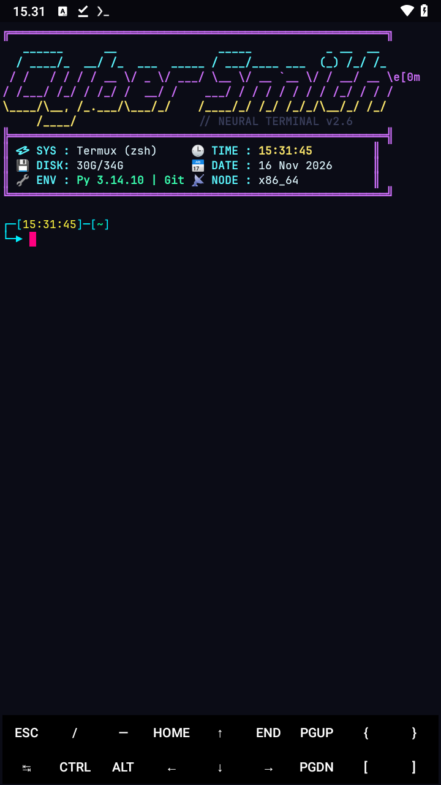

<div align="center">

# ⚡ thema-termuxx ASCII: Cybersmith

_Konfigurasi Zsh & Header Cyberpunk Kustom untuk Termux Android yang Ringan, Interaktif, dan Presisi._

</div>


---

## 1. 🚪 Pintu Gerbang Informasi

Selamat datang di repositori **`thema-termuxx`**! Project ini lahir dari eksperimen untuk menghadirkan antarmuka terminal Android (_Termux_) yang estetis dengan skema warna _Neon Cyberpunk_, namun tetap mengedepankan efisiensi kerja, keterbacaan data sistem _real-time_, manajemen tema interaktif, serta stabilitas navigasi harian.

### Spesifikasi Utama:

- **Shell Framework:** Zsh + Oh My Zsh
- **Interactive UI Engine:** `fzf` & `gum` (Menu pemilihan tema & animasi _startup_)
- **Tema Default:** Cybersmith Cyberfunk (Cyan `#05d9e8`, Magenta `#ff2a6d`, Cyber Gold `#ffb000`)
- **Sasaran Perangkat:** Termux di Android (Optimal pada mode Portrait & Landscape)

---

## 2. 🚀 Panduan Instalasi & Konfigurasi

Anda dapat memasang seluruh konfigurasi ini secara instan menggunakan **metode otomatis satu baris**, atau melalui metode manual.

### Metode Otomatis (Direkomendasikan - 1 Baris Perintah)

Cukup salin dan jalankan perintah berikut di terminal Termux Anda:

```bash
bash -c "$(curl -fsSL https://raw.githubusercontent.com/ar-abdulazis/thema-termuxx/main/install.sh)"
```

_Skrip di atas akan secara otomatis memperbarui sistem, mendeteksi dan memasang dependensi (`git`, `curl`, `zsh`, `python`, `tar`, `fzf`, `gum`, `termux-api`), mengonfigurasi Oh My Zsh beserta pluginnya, mencadangkan file lama, hingga mengunduh konfigurasi tema Cybersmith terbaru._

### Metode Manual (Opsional)

1. Perbarui sistem & instal paket pendukung:

```bash
pkg update && pkg upgrade -y && pkg install git curl zsh nano python tar fzf gum termux-api -y

```

2. Beri izin akses penyimpanan:

```bash
termux-setup-storage

```

3. Unduh repositori dan pasang konfigurasi secara manual ke direktori utama (`~/`):

```bash
git clone [https://github.com/ar-abdulazis/thema-termuxx.git](https://github.com/ar-abdulazis/thema-termuxx.git) ~/thema-termuxx
cp ~/thema-termuxx/.zshrc ~/
mkdir -p ~/.termux
cp ~/thema-termuxx/*.properties ~/thema-termuxx/font.ttf ~/.termux/ 2>/dev/null
termux-reload-settings && exec zsh

```

---

## 3. ⚡ Penjelasan Fitur & Pengoperasian

- **Neural Terminal Header v2.6 (Real-Time):** Banner ASCII kustom dengan panel statistik langsung (Storage `/data`, Waktu, Tanggal, Persentase Baterai, Uptime perangkat, Versi Python, dan Arsitektur CPU) yang dikunci menggunakan format presisi agar bingkai kanan (`║`) tetap lurus.
- **Animated Startup (`gum spin`):** Animasi _loading_ interaktif saat pertama kali membuka sesi terminal baru tanpa membebani proses penyegaran layar berikutnya.
- **Interactive Theme Switcher (`themes`):** Menu pemilih skema warna interaktif berbasis `gum` dan `fzf` yang memungkinkan pergantian tema secara instan (Cyberfunk, Matrix Green, Amber Terminal, Cyber Blue Deep).
- **Anti-Clear Header:** Fungsi _override_ pada perintah `clear` dan pintasan `Ctrl + L` memastikan layar kerja bawah bersih tanpa menghapus banner di bagian atas.
- **Safe Reset & Instant Restore:** Mekanisme penghapusan tema yang aman dengan pencadangan otomatis ke `.zshrc.cybersmith.bak`, dilengkapi perintah `restore-thema` untuk memulihkan konfigurasi kapan saja.

### Ringkasan Shortcut (Aliases & Fungsi)

| Perintah / Alias    | Fungsi Asli                               | Keterangan                                                               |
| ------------------- | ----------------------------------------- | ------------------------------------------------------------------------ |
| `themes`            | Fungsi Interaktif (`gum`)                 | Buka menu interaktif untuk mengganti skema warna tema                    |
| `rc` / `zshrc`      | `nano ~/.zshrc`                           | Edit file konfigurasi Zsh                                                |
| `rl` / `reload`     | `source ~/.zshrc`                         | Muat ulang pengaturan terminal                                           |
| `tc` / `termcolors` | `nano ~/.termux/colors.properties`        | Atur properti warna Termux secara manual                                 |
| `c`                 | `clear`                                   | Bersihkan layar bawah + cetak ulang header                               |
| `sd`                | `cd /sdcard`                              | Pindah ke penyimpanan internal HP                                        |
| `dl`                | `cd /sdcard/Download`                     | Pindah ke folder Download                                                |
| `up`                | `pkg update && pkg upgrade -y`            | Pembaruan seluruh paket Termux                                           |
| `update-thema`      | `exec bash -c "$(curl ... update.sh)"`    | Perbarui tema secara otomatis ke versi terbaru GitHub                    |
| `reset-thema`       | `exec bash -c "$(curl ... uninstall.sh)"` | Hapus tema & kembalikan Termux ke Bash bawaan                            |
| `restore-thema`     | Fungsi Pemulihan                          | Kembalikan tema Cybersmith dari cadangan `.zshrc.cybersmith.bak`         |
| `backup-termux`     | Fungsi Arsip                              | Arsipkan `.zshrc` & `.termux` ke folder `/sdcard/Download/Termux_Backup` |
| `restore-termux`    | Fungsi Ekstrak Arsip                      | Pulihkan konfigurasi dari arsip cadangan `.tar.gz` terbaru               |

---

## 4. 🛠️ Pemecahan Masalah & Kemungkinan Kendala (_Troubleshooting_)

- **Status Baterai (`🔋 BATT`) menampilkan `N/A`:**
- **Penyebab:** Paket `termux-api` belum terinstal atau aplikasi pendamping _Termux:API_ belum terpasang di sistem Android.
- **Solusi:** Jalankan `pkg install termux-api -y` dan pastikan aplikasi Termux:API terinstal serta memiliki izin baterai.

- **Menu `themes` atau animasi tidak muncul:**
- **Penyebab:** Paket `gum` dan `fzf` belum terpasang pada instalasi versi lama.
- **Solusi:** Jalankan perintah `themes` sekali agar skrip menginstalnya secara otomatis, atau jalankan `pkg install gum fzf -y`.

- **Error `parse error` saat memuat `.zshrc` setelah _copy-paste_:**
- **Penyebab:** Karakter spasi tidak terlihat (_non-breaking space_) ikut tersalin dari peramban web.
- **Solusi:** Jalankan `update-thema` untuk mengunduh berkas `.zshrc` mentah yang bersih langsung dari repositori GitHub.

- **Setelah menjalankan `reset-thema`, saat mengetik `exit` malah terpental kembali ke tema Cybersmith:**
- **Penyebab:** Skrip dijalankan di dalam _child process_ Bash tanpa menutup sesi Zsh induk.
- **Solusi:** Pastikan alias menggunakan awalan `exec` (`exec bash -c "..."`) agar sesi Zsh lama digantikan total oleh proses Bash bersih.

---

## 5. 📜 Informasi Lisensi & Hak Cipta

Project **`thema-termuxx`** bersifat _Open Source_ di bawah semangat berbagi ilmu dan pembelajaran bersama. Bebas digunakan, dimodifikasi, serta disebarluaskan kembali untuk tujuan kebaikan dan pengembangan skill pribadi.

---

## 6. 🤝 Kontak & Kontribusi

- **Kreator:** ar.abdulazis
- **Repositori GitHub:** [github.com/ar-abdulazis/thema-termuxx](https://www.google.com/search?q=https://github.com/ar-abdulazis/thema-termuxx)

---

### 👤 Profil Pembuat

> **NAMA** : ar.abdulazis <br>
> **STATUS** : Pembelajar Seumur Hidup & Penggagas Ide <br>
> **MESIN** : Digerakkan Ide, Dibantu AI <br>
> **HAK CIPTA** : Milik Allah Semata, kita mah bukan siapa-siapa. <br>
> _"Bukan ahli, cuma hamba yang sedang menjemput ilmu dan skill agar bermanfaat bagi diri, sesama, dan lingkungan."_

Dibuat dengan ⚡ dan dedikasi penuh di ekosistem Termux Android.

_Terima kasih telah berkunjung, semoga bermanfaat!_
